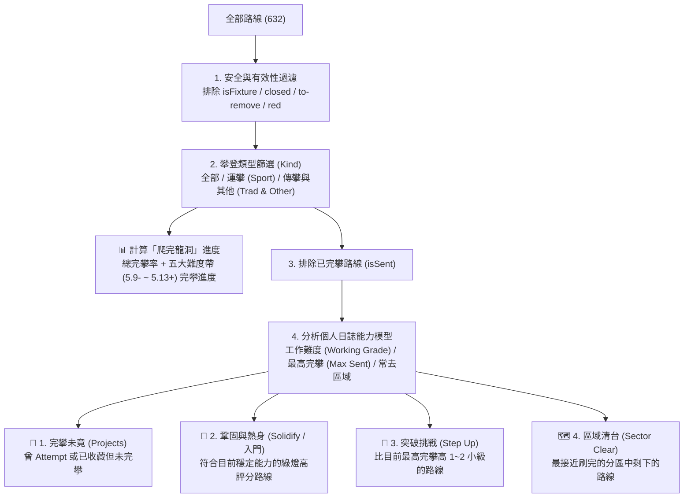

# 龍洞路線推薦與完攀進度系統設計

## 一、目的與結論

在「我的」頁面（[`src/pages/MePage.tsx`](../src/pages/MePage.tsx)）新增**「推薦」分頁**與**「爬完龍洞」完攀進度**。系統完全在裝置本機（Offline-First）運作：依據使用者的個人攀登日誌（`ticks`）、收藏清單（`favorites`）、路線安全狀態與社群評分，計算出個人目前的能力區間，並從四個維度推薦下一步適合攀登的路線，協助使用者循序漸進「爬完龍洞」。

---

## 二、背景與實際資料盤點

經查驗 [`public/data/longdong.json`](../public/data/longdong.json) 實際資料（共 632 筆項目）：

| 分類 | 數量 | 說明 |
|---|---:|---|
| 總項目數 | 632 | 包含攀登路線與非攀登固定點 |
| 非攀登項目（`isFixture: true`） | 7 | 救援訓練固定點、私設固定點等，**不計入攀登路線** |
| **實際攀登路線** | **625** | 運攀 `sport` 208、傳攀 `trad` 329、抱石 `boulder` 44、上方架繩 `toprope` 42、混合 `mixed` 2 |
| 危險或關閉路線 | 35 | 包含 `status: 'closed'`（5）、`status: 'to-remove'`（5）、`safety: 'red'`（28，部分與上述重疊） |
| **安全可攀登路線池（基準分母）** | **590** | 排除 `isFixture`、`closed`、`to-remove` 與 `red` 後的路線總數（其中運攀 190 條、傳攀/其他 400 條） |

### 權責分界（依 `docs/review_and_implementation_protocol.md`）
- **資料結構保證**：由 [`src/data/schema.ts`](../src/data/schema.ts) 保證，`gradeValue` 在匯入時已轉為數值（例如 `5.9 = 36`、`5.10a = 40`、`5.10b = 41`、`5.10c = 42`、`5.10d = 43`、`5.11a = 44`）。
- **推薦與進度計算**：由新增的純函式模組 `src/personal/recommend.ts` 負責，不耦合 React 或 DOM，並由 `tests/recommend.test.ts` 驗證。

---

## 三、功能與演算法設計

### 3.1 安全過濾與可攀登池（Climbable Pool）
任何進入推薦或作為「爬完龍洞」分母的路線，必須同時滿足：
1. `!route.isFixture`（非固定點設施）
2. `route.status !== 'closed' && route.status !== 'to-remove'`（未封閉、非待移除）
3. `route.safety !== 'red'`（非紅燈危險路線）

> **備註**：若使用者過去曾經完攀過某條後來變成紅燈或封閉的路線，在計算「該使用者已完攀數」時仍計入分子與分母（不抹煞既有完攀紀錄），但**絕不會把紅燈或封閉路線推薦給尚未爬過的人**。

### 3.2 攀登類型篩選（Kind Filter）
沿用 [`src/listView.ts`](../src/listView.ts) 的分類慣例，提供三種模式：
- **`all`（全部）**、**`sport`（運攀）**、**`other`（傳攀/其他）**
- **預設模式自動推斷**：
  - 若使用者尚未手動點選，統計其過往完攀紀錄（`isSent`）：若全為運攀（或運攀佔比 $\ge 70\%$）預設為 `sport`；若傳攀/其他佔比 $\ge 70\%$ 預設為 `other`；否則（或無紀錄時）預設為 `all`。
  - 使用者可隨時在「推薦」分頁頂部點擊切換，進度條與推薦清單會即時連動。

### 3.3 個人能力模型（Ability Profile）
根據目前篩選類型下的已完攀路線（`sentRoutes`），計算兩個核心指標：
- **最高完攀難度（`maxGrade`）**：所有已完攀路線中最大的 `gradeValue`。
- **穩定工作難度（`workingGrade`）**：
  - 將已完攀路線的 `gradeValue` 由高到低排序，取**第 3 難**的 `gradeValue`（若完攀總數為 1～2 條，則取最低的那條 `gradeValue`）。
  - **設計理由**：避免使用者偶然 Top-rope 或 Follow 爬過一條超難路線（Outlier），導致系統全部推薦超出其實際穩定能力的路線。取第 3 難能真實反映「目前穩定能完攀的難度」。

### 3.4 路線排序評分（Tie-Breaker）
在同一推薦分類內，候選路線依下列順序排列（取前 `N` 條，預設每類顯示 5 條，可展開或換一批）：
1. **安全燈號**：綠燈（`safety === 'green'`）優先於黃燈／未評級。
2. **固定點狀態**：`rebolted`（已更新）／`tested`（已拉測）優先。
3. **社群星等**：平均星等（`rating.average`）較高者優先（同星等時評分人數較多者優先）。
4. **路線編號**：依官方編號由小到大。

### 3.5 四大推薦維度（互斥不重複：已出現在前序分類的路線不再重複出現）

| 順序 | 維度名稱 | 觸發條件 | 篩選與排序規則 |
|---|---|---|---|
| **1** | **🎯 完攀未竟** *(Projects)* | 有曾嘗試（`attempt`）或已收藏（`favorite`）但尚未完攀的路線 | - 包含所有未完攀的 `attempt` 與 `favorite` 路線 - **排序**：曾 `attempt` 的路線優先（依最近嘗試日期新到舊），其次為 `favorite`（依難度接近 `workingGrade` 程度排序） |
| **2** | **💪 鞏固與熱身** *(Solidify)* *(無紀錄時為「🌱 新手經典入門」)* | 永遠顯示 | - **有完攀紀錄**：選取難度落在 `[workingGrade - 2, workingGrade]`（例如穩定爬 `5.10c (42)`，則推薦 `5.10a (40)`～`5.10c (42)`）的未爬路線 - **無完攀紀錄（新手）**：選取 `gradeValue <= 36`（`5.5`～`5.9`）的路線 - **排序**：依 3.4 評分（綠燈＋高星等優先） |
| **3** | **🚀 突破挑戰** *(Step Up)* | 至少有 1 條完攀紀錄 | - 選取難度落在 `(workingGrade, maxGrade + 2]`（比工作難度高，且最多比最高完攀高 2 小級，例如最高 `5.10b (41)` 則挑戰 `5.10c (42)`～`5.10d (43)`） - **排序**：難度由低到高（先推高 1 小級的），同難度依 3.4 評分 |
| **4** | **🗺️ 區域清台** *(Sector Clear)* | 至少有 1 個分區已完攀 $\ge 1$ 條且尚未 100% 完攀 | - 找出所有「已爬過 $\ge 1$ 條、且還有未爬路線」的分區（Sector） - 優先挑選**「該分區完攀比例最高（或剩餘條數最少）」**且剩餘路線平均難度在 `maxGrade + 2` 以內的分區 - 標題直接顯示：**「區域清台：{區域} · {分區}（已完成 X / Y）」**，列出該分區剩下的路線 |

---

## 四、介面與互動設計（`src/pages/MePage.tsx`）

### 4.1 分頁結構
在「我的」頁面右側區塊（`.me-log`）的分頁切換器擴充為三個頁籤：
- **`攀登紀錄`（`ticks`）** ｜ **`收藏`（`favorites`）** ｜ **`推薦`（`recommend`）**

### 4.2 「推薦」頁籤內容版面
1. **類型篩選列（Chips）**：`全部` ｜ `運攀` ｜ `傳攀/其他`
2. **「爬完龍洞」總進度卡片（`.card`）**：
   - 標題與總進度數字：例如 **「龍洞完攀進度：42 / 190 條（22%）」**
   - 整體水平進度條（Progress Bar）
   - **各難度區間完成度**（複用 [`GRADE_BANDS`](../src/format.ts)：`5.9-`、`5.10`、`5.11`、`5.12`、`5.13+`）：顯示每個區間「已完攀 / 該區間總數」（例如 `5.9-  18 / 35`、`5.10  20 / 82`），一眼看出哪個難度帶最接近刷完。
3. **四個推薦路線區塊**：
   - 每個區塊有標題與簡短說明（例如：「依你目前穩定完攀 5.10b，推薦同級經典路線」）。
   - 路線列表直接複用現有的 [`<RouteRow item={ref} showPlace />`](../src/components/RouteRow.tsx)，保持全站視覺、星等、安全燈號、電腦版雙欄預覽（Master-Detail）與鍵盤 `↑↓` 導覽完全一致。

---

## 五、檔案改動清單

| 檔案路徑 | 改動性質 | 說明 |
|---|---|---|
| `src/personal/recommend.ts` | 新增 | 能力評估、完攀進度統計、四大維度推薦純函式 |
| `tests/recommend.test.ts` | 新增 | 針對新手、老手、Outlier 濾除、紅燈/封閉過濾、互斥去重、區域清台之單元測試 |
| `src/pages/MePage.tsx` | 修改 | 新增「推薦」頁籤、進度卡片與推薦列表渲染 |
| `src/i18n/zh.ts` & `src/i18n/en.ts` | 修改 | 新增推薦分頁與進度條相關之中英文字串 |
| `src/styles.css` | 修改 | 新增進度條與推薦區塊副標題的精簡樣式 |

---

## 六、待確認與可調整細節（討論點）

1. **「爬完龍洞」進度卡片的位置**：
   - 目前規劃放在**「推薦」分頁的最上方**（隨「全部／運攀／傳攀」切換即時改變分母）；或者你希望左欄的統計區（難度金字塔旁邊）也常駐顯示總進度？
2. **每個推薦分類顯示的路線數量**：
   - 預設每個分類顯示 **5 條**最推薦的路線（若點「顯示更多」可展開），這樣頁面長度最剛好，你覺得合適嗎？
3. **未登入時的體驗**：
   - 目前「我的」頁面在未登入時只顯示登入引導卡片。是否要在未登入時的介紹清單（`me.feature.*`）也加上「路線推薦與完攀進度」的說明？
